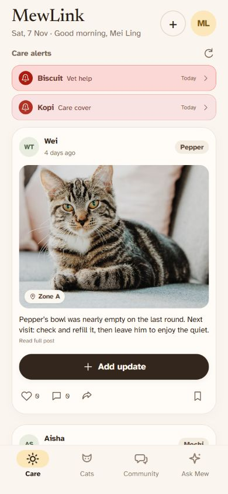

# Alert red palette correction — 2026-11-07

All individual care-alert strips now remain visibly red. Ranked saturation decreases from 84% to 65%, with pale red backgrounds and red icons/borders at every level. The earlier lowest-saturation grey/brown tone has been replaced. Layout, event qualification, priority ordering and detail behavior are unchanged.

- Production: `dpl_28yUTRRJC9Gwo3m5kiivSJXHvrzZ`, https://mewlink-experiments-n4j3rfmdi-zby336.vercel.app/.
- Public: https://mewlink-experiments.vercel.app/.
- Build: 63 files, 1,144,474 bytes. All production file hashes match the local build.
- The only changed deployment file relative to [v1.6](individual-alerts-2026-11-07-files.json) is `care-feed-ui.js`, SHA-1 `9a9c22019b33e0f19ae1ecd62004cddb7e6ed347`.
- Build and whitespace checks passed. Preview and production were visually checked at 390 × 844; both strips retained 44px height. No new test was added for this numeric colour adjustment; preceding logic checks are documented in v1.6.
- GitHub, Figma, original projects and backups were not modified.

