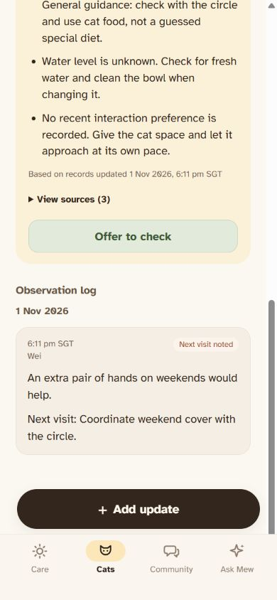
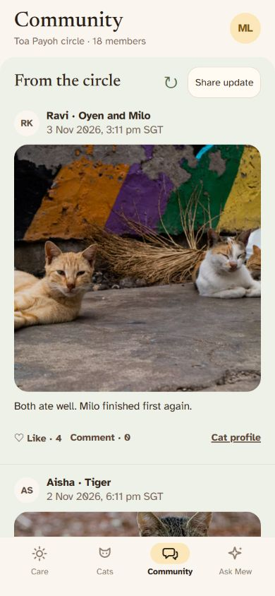

# Approved UX11 release — 2026-11-03

The user approved https://mewlink-experiments.vercel.app/ and authorized synchronizing the complete current website source to GitHub. The target is the same experimental repository ID `1444108864`, now named `zby336/mewlink-prototype-v4`. The original v3 repository and backup projects are not update targets.

## Accepted website snapshot

- Project: `mewlink-experiments` / `prj_8ennCAToI4d6FiFzmsOznsrFeBNo`.
- Deployment: `dpl_4jFh3aALVjU74WFduQvmdPJFcjfS`.
- Immutable URL: https://mewlink-experiments-lhnocquvp-zby336.vercel.app/.
- 60 deployment files, 1,082,163 bytes. Every local manifest SHA-1 matches the deployment source-file SHA-1 returned by Vercel.
- [Exact accepted build manifest](approved-ux11-files.json). The committed `dist/` is this snapshot; source rebuilds offline with Node.js 22+.

## Included refinements since the independent copy

- Dark-brown Add update buttons with consistent native press feedback and reduced-motion handling; all cat profiles now have fixed **+ Add update** above the Cats navigation.
- Corrected profile-photo framing; exactly one eligible public caregiver crown, choosing most valid care records then latest care to break a tie, without disclosing hidden/private winners.
- Report form for a current alert, explanation, validation, cancellation, safe-area footer and storage-failure recovery. The compact Report pill matches the alert tag size and aligns to the card edge. Copy reads “Flag an issue for our team to double-check.” Success does not claim an upload or completed operator review.
- Muted `#EEF1E8` Community feed, no lower divider, pull-to-refresh, preserved local social state and existing Group Chats.
- Slightly larger responsive Ask Mew placeholder; personal cat rings match Care's pale TNR colours.
- A shared sage **Offer to check** on profiles whose suggestions cite a current next-visit request. Offers persist per browser, appear in Follow-up and can be withdrawn. Requests remain open until evidence resolves them. Offers never add care records, feeding evidence or public posts. Older offers do not silently apply to a different source request.
- Existing records, onboarding, retrieval, caregiver privacy, cat confirmation and final-save-only care flow remain.

## Validation

- 84 automated tests passed, 0 failed. Includes offer eligibility, persistence, deduplication, privacy/expiry/completion filtering, source replacement, storage failure, Follow-up/Handover integration and existing care/privacy/social behavior.
- Build, JavaScript syntax and whitespace checks passed.
- Browser: Bubu Offer → Follow-up; reload retains the offer; Undo removes Bubu from Follow-up. Existing Tiger Follow-up status and Kopi Handover membership remain.
- Milo fixed Add update opens a draft for Milo. Care/Tiger/Kopi entry and cancellation were checked during UX10.
- 360 × 640: Save report bottom at 624px; fixed profile Add update bottom at 540px, above the 556px navigation boundary. 390 × 844: fixed button, navigation and sage offer inspected.
- Earlier UX07 browser checks covered all twelve faces and default crowns, Community refresh, Report submission and Group Chats. A physical-phone touch test has not been performed.

## Data and design boundaries

The app remains a pure frontend prototype. Records include seeded sample observations plus explicit browser-local actions. Offers are intentions, not completed visits. Reports are local and no operator database/review endpoint is connected. Ask Mew and care suggestions use deterministic source retrieval and rules, not a generative LLM. Browser-local user data and credentials are not uploaded to GitHub.

Figma https://www.figma.com/design/7fVfuvgTh5E7zMGg2sDwKj remains the editable experimental copy, with earlier design-to-code gaps and no UX07–UX11 synchronization. This GitHub synchronization does not modify or claim to update Figma.

