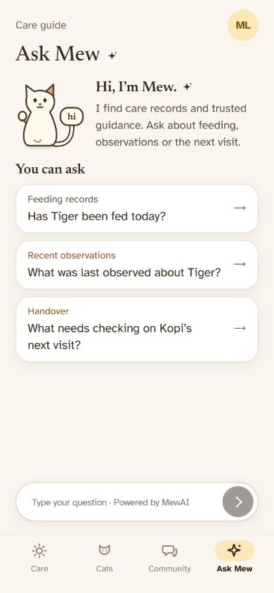

# Ask Mew illustration — 2026-11-07

The Ask Mew welcome illustration now uses the same crisp vector rendering as the joined confirmation. Its size, position, expression and surrounding UI are unchanged. No data or retrieval logic changed.

- Production: `dpl_86DyuNyEdQj1aZDZmuNMPJYbgryv`, https://mewlink-experiments-8optn1152-zby336.vercel.app/#askmew.
- Public page: https://mewlink-experiments.vercel.app/#askmew.
- Build: 62 files, 1,127,951 bytes. All 62 hashes match production.
- The only changed deployment file relative to [v1.3](care-saved-posts-2026-11-07-files.json) is `assets/1036ed9f-3e3e-4b9a-9776-2114ce3b65b3-0.bin`, 18,826 bytes, SHA-1 `9cdc655e16919616be05c6b58f94a5c0b0b92cf3`.
- Build and whitespace checks passed. Preview and public browser checks at 390 × 844 confirmed the visible SVG group's filter is `none` and the existing Ask Mew layout is retained. No new test was added for this one-property visual change.
- GitHub, Figma, original projects and backups were not changed.

