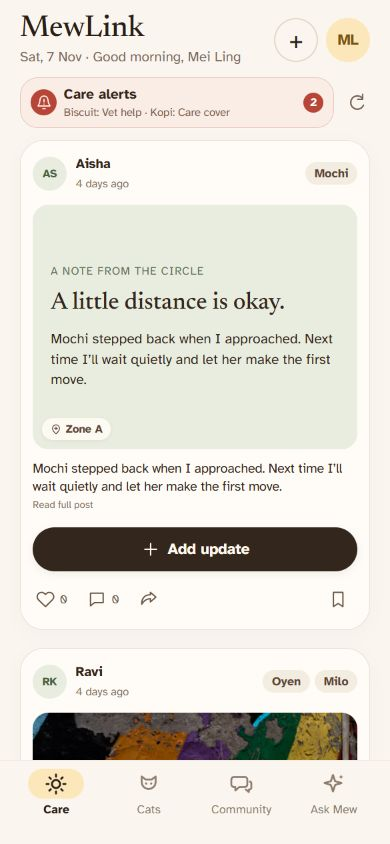
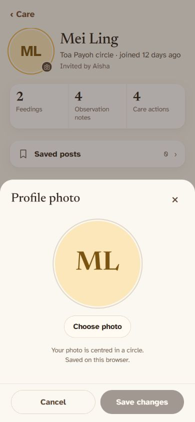

# Care Home v1.5 — profile photos and text-post zones

Published only to https://mewlink-experiments.vercel.app/ on 2026-11-07.

- Production: `dpl_3KFAVpcAgXbdjJSQv6XkpL6Qe5Kk`, https://mewlink-experiments-52i2j5glf-zby336.vercel.app/.
- Tested preview: `dpl_289EBbpWmAk3vTp4AvF44GATdrYV`, https://mewlink-experiments-izzbmkvav-zby336.vercel.app/.
- Project: `prj_8ennCAToI4d6FiFzmsOznsrFeBNo`.
- Build: 63 files, 1,142,320 bytes; [manifest](avatar-upload-2026-11-07-files.json). Every file hash matches production.
- Previous local checkpoint: `e3af504`; work remains on `feature/care-home-feed-2026-11-07`.
- No GitHub push/PR, Figma edit or backup/original-project modification.

## Changes

- Removed the inline cat-name/zone line inside text-story frames. Text, image and video frames now share the small zone badge at the bottom left; multi-cat zones continue to be deduplicated from actual catalogue data.
- The large Profile avatar is an accessible **Change profile photo** button. Its sheet supports a real image-file picker, circular preview, explicit save, cancel and removal. A camera badge makes the entry visible.
- Chosen images are decoded, centre-cropped to a square and converted to a bounded JPEG, at most 512px per side without upscaling. The preview appears before saving. Invalid/oversized images and storage errors show an error without replacing the existing avatar; cancel and navigation invalidate in-progress work.
- Saved images update Care, Cats, Community and Ask Mew profile entrances, current-user post avatars and current-user caregiver avatars when those identities are already eligible for display. The existing caregiver privacy filter, fading and crown logic are preserved.

## Data boundary

`mewlink-profile-avatar-v1` stores the prepared JPEG data URL and update time in this browser. Existing care, social and privacy keys are untouched. This is real local file selection and image processing, with browser persistence; it is **not** a server upload, account profile service or cross-device sync. No API, external storage, AI or backend was added. Original photo metadata is not retained in the prepared JPEG. User-selected avatars are not bundled into source or deployments.

## Verification

- 116 automated tests passed. New tests cover save/replace/remove, data separation, invalid/oversized/failed writes, malformed saved data, centred square geometry and input validation.
- Build, syntax and whitespace checks passed.
- Isolated preview: selected a real AVIF photograph already referenced by the prototype; it decoded to a circular preview, saved as JPEG and remained after reload. No QA photo was saved on the production origin.
- Remove → Cancel retained the original image. Remove → Save changes restored ML and stayed removed after reload.
- Confirmed uploaded images in Care, Cats, Community and Ask Mew header entrances. No JavaScript errors were reported in the final preview check.
- At 360 × 640 the sheet's save button bottom was 624px, fully visible. At 390 × 844 the large avatar retained its existing ring and profile layout.
- Luna text-frame DOM had no old small footer line and one Zone C badge. Public text posts and the avatar editor were inspected after release; all 63 production hashes match the tested build.
- Physical-device camera/HEIC behavior and cross-device accounts were not tested or implemented.

