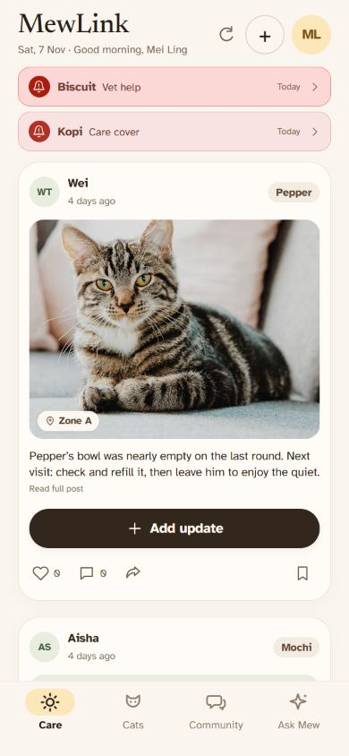

# Compact Care header — 2026-11-07

Removed the visible Care alerts heading while keeping the individual red event strips and their detail sheets. Feed refresh now sits immediately left of the existing Create (+) control in the top header. The removed heading row brings alerts and posts upward. The greeting truncates with an ellipsis on narrower screens so the three header actions fit.

- Public: https://mewlink-experiments.vercel.app/.
- Production: `dpl_DEXU7gP58dMPubWcDDJ3fJWdfJT9`, https://mewlink-experiments-f8rlko74w-zby336.vercel.app/.
- Preview: `dpl_8QXGVupWDncbK8RQwUQ2tUEDXZji`.
- Build: 63 files, 1,144,653 bytes. All production hashes match the [local manifest](care-header-refresh-2026-11-07-files.json).
- Validation: 119 automated checks passed; build and whitespace checks passed. Preview checked at 390 × 844 and 360 × 640; refresh, duplicate refresh handling, alert detail and the Create menu passed. Public production was visually checked at 390 × 844. No browser errors were observed in preview testing.
- This is a presentation change; the existing browser-local prototype data and behavior remain. GitHub, Figma, original projects and backups were not modified.

