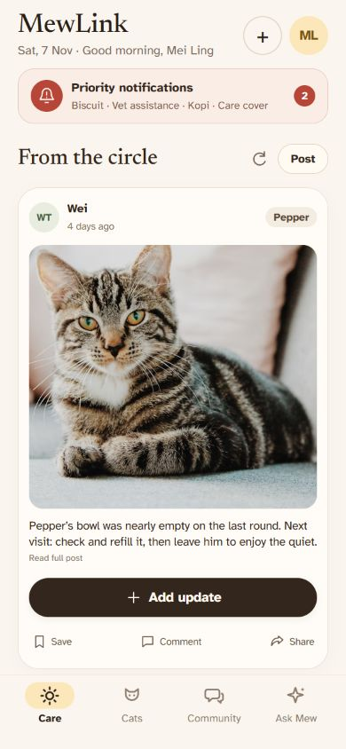
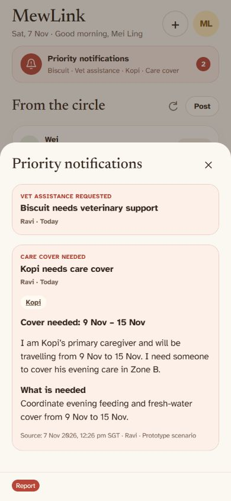

# Care Home v1 — 2026-11-07

## Version checkpoints

- Previous approved UX11 commit: `3faca356d68470fafcc3dd213736ed28fcffbfe5`.
- GitHub backup branch: https://github.com/zby336/mewlink-prototype-v4/tree/backup/ux11-before-care-redesign-2026-11-07.
- Previous website snapshot: https://mewlink-experiments-ou1679co9-zby336.vercel.app/ (`dpl_4uod3NM8WFET6WcztEWN4h5vQpjB`).
- Offline source backup: `outputs/mewlink-ux11-backup-2026-11-07.zip` in the enclosing workspace. Complete pre-change Git history: `outputs/mewlink-ux11-history-2026-11-07.bundle`.
- New local development branch: `feature/care-home-feed-2026-11-07`. GitHub main remains at UX11; no new implementation has been pushed to main.
- Current public experiment: https://mewlink-experiments.vercel.app/.
- New deployment: `dpl_5kVHxxBsTpimR6TTnk1wXmwNCmyw`, https://mewlink-experiments-9iwy523q8-zby336.vercel.app/.
- Exact build: 62 files, 1,124,057 bytes; [SHA-1 manifest](care-home-2026-11-07-files.json). All 62 hashes match the Vercel deployment file tree.

The original v3 repository, backup website, original Netlify and all Figma files were not modified. Restore the old design from the backup branch/ZIP or the immutable old deployment. Browser-local user data is separate from a code snapshot and is not uploaded into these backups.

## Scope and design

Read only section “二、网站原型” in `MewLink-11月5日咨询修改建议.md`, following the user's explicit Care-page specification. No presentation or poster edits were made.

Care now has two content areas below the preserved brand/header:

1. A compact red priority-notification entry. Only explicit primary-caregiver travel/relocation coverage requests and explicit medical-support requests qualify. Routine observations, water checks, mild ear observations or missing feeding records do not become urgent notifications. Expanded items show the exact recorded description, author, source time, required action and dated cover period. Each related cat name links to its profile.
2. A single-column portrait feed. Cards have the same fixed dimensions within each viewport, with one fixed grid row for Add update and a small Save / Comment / Share footer. Supports image albums with horizontal swipe and arrow controls, text cards and native video controls. Full text is available in a dialog, without changing card size.

The top-right Add a cat and My profile controls are byte-identical to the preceding Care header. Existing navigation, Cat Profiles, caregiver fading/crowns, Community, Ask Mew and final-save-only Add Care Update remain. Multi-cat posts require choosing the target cat before entering the existing confirmation flow. No care note is automatically posted publicly.

Opening Care or tapping its active tab rereads and reorders the saved feed; pulling downward at the top or clicking Refresh does the same. Refresh never invents new activity. Horizontal gestures, short/retracted pulls, media controls, open dialogs and busy refreshes are guarded. Videos pause when a dialog opens, a refresh starts, the video leaves view or the page is left.

Care Basics remains accessible under My profile, and invite-free joining is explained more clearly on Welcome.

## Data and prototype boundaries

Existing local notes, drafts, contributions, social state and preferences are preserved. New keys:

- `mewlink-care-home-scenarios-v1`: two scenario records, written once on first entering the new Care page. The source labels them as **Prototype scenario** in notification details. One is dated evening cover for Kopi's primary caregiver's travel; one is a request for veterinary support for Biscuit's front-left-paw observation. These are sample scenarios, not inferred real events. The same source records appear in profile logs and local Ask Mew retrieval.
- `mewlink-saved-posts-v1`: per-browser saved-post IDs. No care or feeding record is created by saving a post.

Feed text/album examples reuse existing sample observations and photo references. Shared posts and comments reuse the existing social store. New posts support up to five photos or one video; photos are prepared at a bounded resolution, and prototype video uploads are limited to 2 MB. Failed storage writes do not claim success.

This remains a frontend prototype: no shared database, live multi-user feed, operator report queue, account backend or generative model was added. A copied link to a browser-local post does not transfer its local data to someone else. Native Share is delegated to the browser's system share sheet. Figma remains unsynchronized with this redesign.

## Verification

- 98 tests passed; build, JavaScript syntax and whitespace checks passed.
- Priority rules: ordinary/missing care excluded; explicit medical/dated primary-caregiver coverage included; private, foreign-circle, future, unknown-cat and resolved records excluded.
- Browser: notification expansion and precise cover dates; Biscuit link opens the matching profile with the same source record and next-visit request.
- Browser: saves, comments, copied share link, existing two-photo carousel and repeated Care-tab refresh work. An actual mouse pull displayed Refreshing. Touch-equivalent thresholds and horizontal/cancel cases are covered by tests; physical-phone gestures were not tested.
- Browser: QA-only 5-second MP4 uploaded and posted on an isolated preview origin. Native controls loaded metadata (5.055s, 960px width) and playback started without error. That QA post/video is not seeded or deployed on the public website.
- Browser: Add update from Bubu opens Bubu's draft; an Oyen/Milo post presents a choice and opens Milo's draft only after choosing Milo. Existing drafts are retained on Cancel.
- Browser: 390×844 cards measured 350×542.5; desktop cards 400×620. At 375×667 every card had the same dimensions with no horizontal overflow. At 360×640 the report button bottom was 624px, fully visible.
- Browser: Care Basics opens from My profile. No JavaScript error was reported in the final preview check.
- Every production file hash matches the tested local build. GitHub main and the backup branch still point to UX11.

