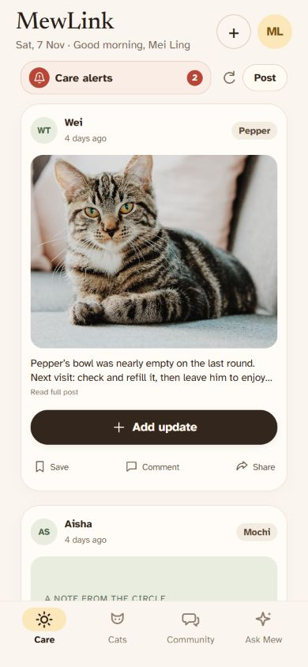
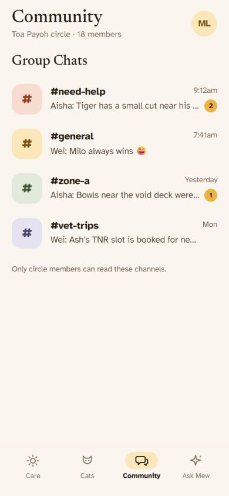

# Care Home v1.1 — 2026-11-07

Published only to https://mewlink-experiments.vercel.app/.

- Production deployment: `dpl_8oyVRvp8Vgop38f5cJpp7dX9jdqx`.
- Immutable URL: https://mewlink-experiments-rl8ovs35b-zby336.vercel.app/.
- Project: `prj_8ennCAToI4d6FiFzmsOznsrFeBNo`.
- Exact build: 62 files, 1,125,664 bytes; [file hashes](care-home-polish-2026-11-07-files.json). All 62 SHA-1 hashes match production.
- Local branch: `feature/care-home-feed-2026-11-07`; previous Care Home v1 commit `75b365292782825c883d3276dc167aa5d076e097` is retained.
- No implementation was pushed to GitHub. No Figma file, original project or backup website was modified. See [the preceding release](care-home-2026-11-07.md) for UX11 backups and prototype boundaries.

## Changes

1. Add a cat now offers **Cats I’d like to follow up**. The next screen explains that selections appear in **Cats → Follow-up** and lists the real catalogue for the selected zone. Removed the redundant “Can’t find them?” link. Successful selection opens Follow-up directly, without claiming feeding, completed care or a notification to other caregivers.
2. **Care alerts** replaces Priority notifications. Its compact entry shows an icon and count; descriptions remain inside the dialog. Refresh and Post sit alongside it, with no separate From the circle heading. Portrait posts retain their fixed layout, Add update and Save/Comment/Share controls while shrinking slightly. The original top-right plus and avatar are unchanged.
3. Removed the duplicate From the circle feed from Community. Group Chats and existing conversations remain available. No posts or comments were deleted.

## Data behavior

`mewlink-followed-cats-v1` stores valid followed-cat IDs in this browser. Valid legacy selections from `mewlink-joined-cats` remain recognized without rewriting the old value. New selections add to the current list and deduplicate IDs. Manual follows coexist with existing Offer to check requests and Handover categories. A failed write retains the selection and shows an error instead of success.

Following does not create feeding, care, social or check-offer records. Existing browser-local notes, drafts, posts, preferences and selected cats are preserved. This is still a frontend prototype with sample records and browser-local persistence, without a shared account/database or live operator service.

## Verification

- 102 automated tests passed, including catalogue/zone selection, legacy selections, additive persistence, storage failure, no care/social mutations and coexistence with offers.
- Build, JavaScript syntax and whitespace checks passed.
- Isolated preview: selected Pepper in Zone A and Bubu in Zone C; success opened Cats → Follow-up with both cats and the pre-existing item. They remained after reload.
- 390 × 844: Care alerts entry measured 42px high; all seven cards measured 338 × 490.09px.
- 360 × 640: cards measured 308 × 450px; toolbar fit without horizontal overflow. Post opened with its submit control fully visible, and Refresh returned Feed refreshed.
- Community contained Group Chats only; an existing general chat opened normally.
- Public production: verified compact Care toolbar and posts, and Community without the duplicate feed. All 62 deployment hashes match the tested build.
- Earlier end-to-end care-save, notifications, media and sharing checks are documented in Care Home v1. Physical-device gesture testing has not been performed.

