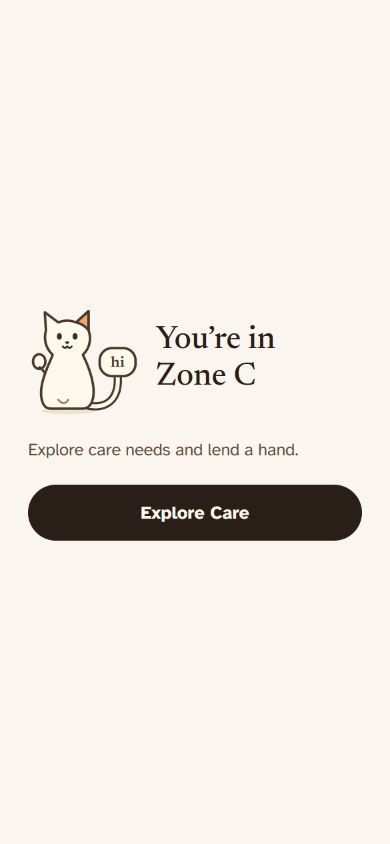
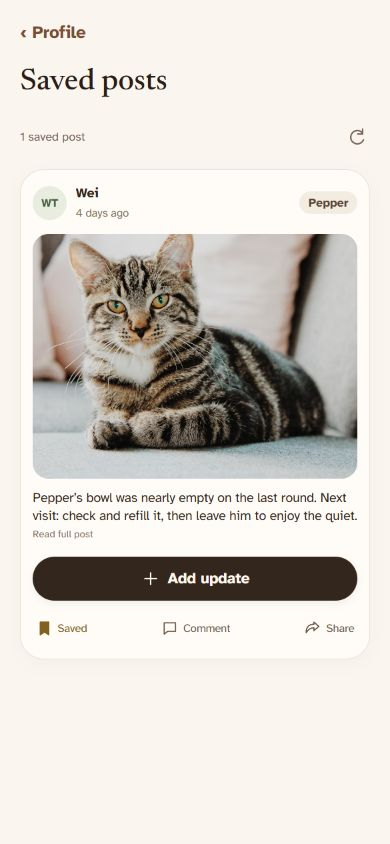

# Care Home v1.3 — joining and saved posts

Published only to https://mewlink-experiments.vercel.app/ on 2026-11-07.

- Production: `dpl_AGun3dCsgMtGnvmxxcnKFNohh7oX`, https://mewlink-experiments-oqvrtef8g-zby336.vercel.app/.
- Tested preview: `dpl_AXgr2x6MFJ6chKRtXpRAajUuzd1Y`, https://mewlink-experiments-izpg1x9xh-zby336.vercel.app/.
- Project: `prj_8ennCAToI4d6FiFzmsOznsrFeBNo`.
- Exact build: 62 files, 1,127,940 bytes; [SHA-1 manifest](care-saved-posts-2026-11-07-files.json). Every hash matches production.
- Previous local checkpoint: `b738303`; retained on `feature/care-home-feed-2026-11-07`.
- No GitHub push, PR, Figma edit or change to the accepted backup/original projects.

## Changes

- Welcome primary action now says **Join your local care circle**. The optional invite path and original joining logic remain.
- Successful invite confirmation places the Mew mascot beside **You’re in Zone C**, with the saved zone inserted dynamically. The supporting line is **Explore care needs and lend a hand.**, without repeating the zone. Request-mode confirmation remains distinct from accepted joining.
- The success mascot uses the existing vector illustration with an optional crisp rendering mode that disables its roughening filter. Other Mew illustrations retain their existing treatment.
- **ML → Saved posts** provides a visible collection of bookmarked Care posts, with a count near the top of Profile. It reuses the existing card, comments, sharing, media and Add update controls. Unsave removes the card from this collection; an empty collection explains how to save and links back to Care.

## Data

Saved posts reuse `mewlink-saved-posts-v1`. Existing bookmarks are recognized immediately, including bookmarks made before a collection screen existed. No migration, duplicate post or care record is created. Unavailable IDs are omitted. Saved posts remain in this browser and are not shared across accounts or devices; no backend was added. Joining mode and selected zone continue using the preceding release's stored context.

## Verification

- 107 automated tests passed. Tests include saved collection retrieval from pre-existing storage, unavailable IDs, unsaving to an empty collection and no care/social mutations. Zone tests verify the title contains the selected zone and invite-mode supporting text does not repeat it.
- Build, syntax and whitespace checks passed.
- Isolated preview: Profile opened an empty collection; saved an Oyen/Milo post in Care, saw Profile count 1 and the matching card, reloaded and retained it. Comments opened normally; unsaving returned to the empty state.
- Preview invite flow selected Zone C, then showed the mascot at left and You’re in Zone C at right. Refresh retained the correct title. The vector group's filter was `none`.
- At 360 × 640 the new primary action measured 312px wide with equal scroll/client widths; the success title remained inside the viewport. Collection empty-state navigation worked. At 390 × 844 the saved post retained the existing fixed card layout.
- No browser errors were reported in the preview check.
- Public verification found an existing Pepper bookmark without changing it. Profile and Saved posts displayed the correct count and card. The public welcome button matched the verified source.
- No physical-device test was performed. Broader retained behavior is documented in the preceding release reports.

