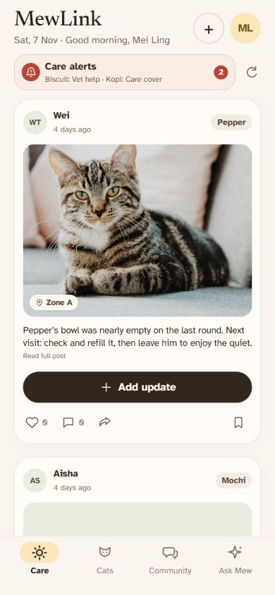
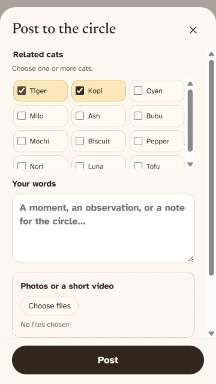
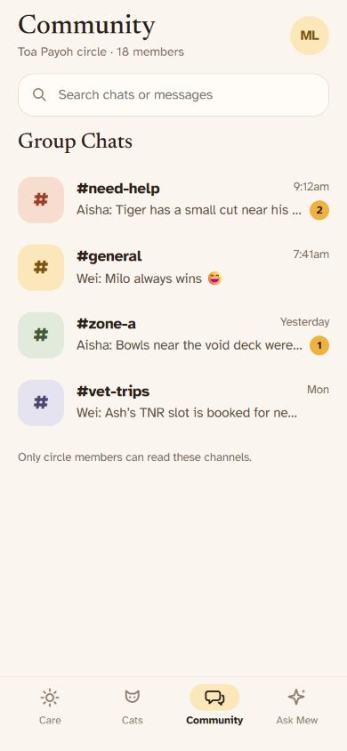

# Care Home v1.4 — alerts, social actions and Community search

Published only to https://mewlink-experiments.vercel.app/ on 2026-11-07.

- Production: `dpl_7pztDvGB7E4PUWcCtVDptrPUHVug`, https://mewlink-experiments-duptk1pi7-zby336.vercel.app/.
- Final tested preview: `dpl_8TDzphWE7aHLRXJeXYL17c9ua1A2`, https://mewlink-experiments-pxm119hsl-zby336.vercel.app/.
- Project: `prj_8ennCAToI4d6FiFzmsOznsrFeBNo`.
- Build: 62 files, 1,132,503 bytes; [manifest](care-social-2026-11-07-files.json). All hashes match production.
- Previous local checkpoint: `ab6beec`. Work remains on `feature/care-home-feed-2026-11-07`.
- No GitHub push/PR, Figma edit or backup/original-project modification.

## Changes

- Care alerts now includes a concise, sourced summary such as **Biscuit: Vet help · Kopi: Care cover**. It uses only the existing qualified urgent requests; opening the alert still provides complete details and cat links.
- Photos and videos show recorded zone labels at the bottom left. Multi-cat posts show each distinct recorded zone; text posts retain their zone line. Albums leave room between navigation and the zone badge, and video badges sit above native controls.
- The footer now shows **Like + count, Comment + count, Share** at left, with **Save** at right. Icon controls keep English accessible labels. Like state and counts use the existing social store; no fake share count is introduced. Saved posts reuse the same controls.
- The post form offers multiple cat checkboxes, preserves selections through attachment preparation, and uses English file-selection controls. Posts retain all selected cat IDs; their profile links and Add update cat choice match the selection. Sharing an already saved care record continues to respect that record's confirmed or unconfirmed identity instead of overriding it with post selections.
- Community includes **Search chats or messages**, filtering existing channel names, member descriptions, message authors/history and current local messages. Matching channels open the original chat; an empty result has a clear message.

## Data boundaries

Existing browser-local care records, drafts, bookmarks, likes and comments are preserved. No new storage key or backend was added. Likes, comments, posts and bookmarks are prototype actions on this browser, not live shared community data. Posting never confirms feeding or creates a care observation. Source fixtures remain sample records. The app's upload labels are English; the system file chooser uses the device's language.

## Verification

- 113 automated tests passed. Added checks cover multi-cat publication/deduplication/invalid IDs, preserved saved-record identity, all three post types' like counts without care/bookmark mutations, qualified urgent summaries, Community search and the composer's actual multi-cat submit handler.
- Build, JavaScript syntax and whitespace checks passed.
- Preview: liked Pepper and retained the state after reload. In the first preview, selected Tiger and Kopi, attached a PNG and confirmed both remained checked with English attachment status. An old single-cat submit guard was found, removed and covered by a regression test.
- Final preview: an empty selection displayed Choose at least one cat. Published a Tiger/Kopi text post; both profile links and Zone A/Zone B appeared. Like and comment counts reached 1, Share opened, Save persisted after reload and the post appeared in Saved posts. Add update asked which of the two cats to visit.
- Community: Tiger found need-help, the chat opened normally, an unmatched query showed no results and clearing restored all four channels.
- 360 × 640: footer action order was Like → Comment → Share → Save, with Save aligned to the right. The post-submit button bottom was 624px, fully within the viewport. The form body scrolled normally.
- Public Care and Community were checked after deployment; source hashes match the tested build. QA posts/comments/attachments were confined to preview origins and are not seeded on production.
- Physical-device gestures were not tested; prior retained flows are documented in earlier releases.

