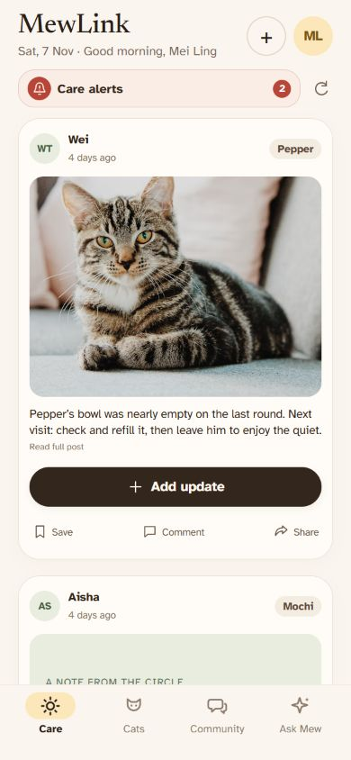
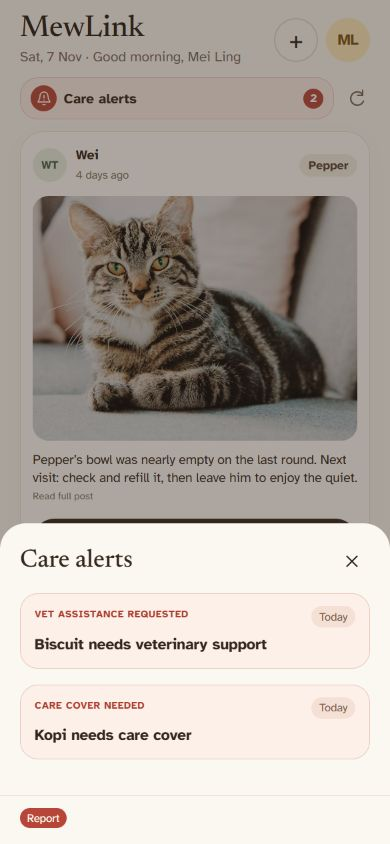
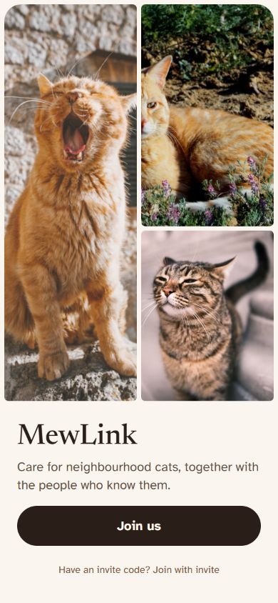
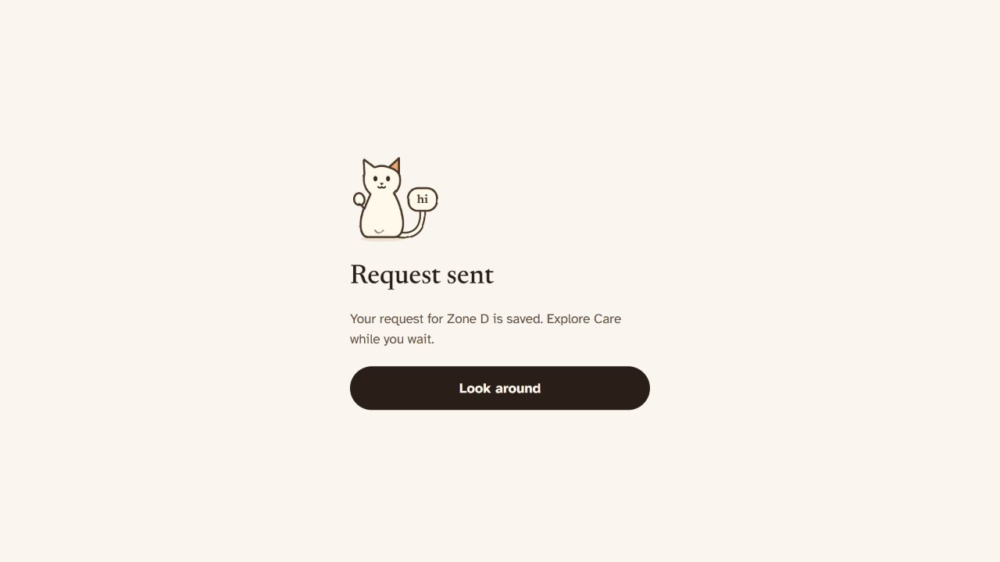

# Care Home v1.2 and joining polish — 2026-11-07

Published only to https://mewlink-experiments.vercel.app/.

- Production deployment: `dpl_2NjW6bGWwJzPLD13ySHnksx8aqfR`.
- Immutable URL: https://mewlink-experiments-duwid3zho-zby336.vercel.app/.
- Tested preview: `dpl_5HykGQ2X44GAzbLSnJFXnTMD6vnG`, https://mewlink-experiments-l2a8eijpm-zby336.vercel.app/.
- Vercel project: `prj_8ennCAToI4d6FiFzmsOznsrFeBNo`.
- Exact build: 62 files, 1,126,829 bytes; [manifest](care-welcome-2026-11-07-files.json). All 62 SHA-1 hashes match production.
- Previous local checkpoint: `a084176` (Care Home v1.1). Current work remains on local branch `feature/care-home-feed-2026-11-07`.
- No GitHub push, PR or remote-repository change. No Figma, backup website or original project edits.

## Changes

1. Care cards and toolbar now share the header's 20px side margins. The original plus and ML avatar keep their appearance. The plus opens **Create**, with **Post** and the existing **Add a cat** action. Removed Post from the alert toolbar; explicit refresh and pull refresh remain.
2. Collapsed alerts show a small relative-date badge at the top right. The author and full source time remain available only after expansion, alongside the original precise description, action, period and cat links.
3. Welcome keeps the three-tile animated composition and five existing photos. One tile changes per tick, and the incoming image is absent from all three previous tiles, preventing duplicate photos during the crossfade as well as between transitions. The main action is **Join us**; a smaller **Have an invite code? Join with invite** control reveals the existing invite-code path. Removed the optional-invite explanatory sentence. Intro now reads **Care for neighbourhood cats, together with the people who know them.**
4. Joined/request confirmation reuses the existing Mew line-art mascot instead of a cat photograph. The selected zone and invite/request path survive component remounts, the Care Basics step and refresh. Confirmation text is concise and includes the zone. The older incorrect Care Basics location sentence is removed from this success screen.

## Data and boundaries

Existing records, followed cats, posts, drafts and privacy preferences are preserved. New `mewlink-join-context-v1` stores only the joining mode and selected zone. `mewlink-zone` and the existing profile-answer store continue to hold the user's answers. A malformed profile-answer JSON value no longer hides a valid separately saved zone.

Joining, invitations, requests, comments and posts remain frontend prototype interactions. No real invite validation, account, shared database, live admin review or model service was added. The established mandatory-basics condition is retained: no cats at home plus New to this/Under 1 year, unless already completed. Tests use an isolated preview origin, without changing the user's public-site preferences.

## Verification

- 106 tests passed, including 300 collage transitions with no cross-tile collision, all four zones in both joining modes, remount/refresh after learning, malformed-answer recovery and separate optional invite routing.
- Build, syntax and whitespace checks passed.
- 390 × 844 preview: all seven posts measured left 20px and right 370px, exactly matching the MewLink left edge and ML right edge. Height remains 490.09px.
- 360 × 640 preview: cards measured left 20px, right 340px and height 450px. Invite expansion remained usable and both joining actions fit. Refresh returned Feed refreshed.
- Plus → Post opened the original photo/video/text composer. Plus → Add a cat opened the existing follow-up/new-sighting choice.
- Collapsed alerts showed Today at top right without Ravi; expanded Kopi showed the dated cover period, request and Ravi's source details.
- Invite path: selected Zone C, joined without mandatory basics using home-cat/experienced answers; correct Zone C and mascot remained after refresh.
- Join us path: selected Zone D with No / Under 1 year, completed all four learning cards, then saw Request sent with Zone D. Both mode and zone remained after refresh.
- No browser errors were reported in the preview check. Final public Care, alert badges and Welcome were checked and captured. No physical-phone test was performed.

