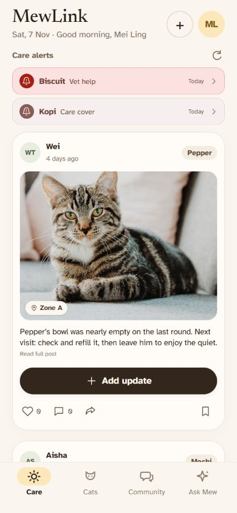

# Care Home v1.6 — individual alert strips

Published only to https://mewlink-experiments.vercel.app/ on 2026-11-07.

- Production: `dpl_2WdL6U2CtktYjU4CAQX7SJ2onaT7`, https://mewlink-experiments-6s93skafh-zby336.vercel.app/.
- Tested preview: `dpl_GkKbes7rfn9UF2yK7gajBEjxs17W`, https://mewlink-experiments-1kleo22f5-zby336.vercel.app/.
- Vercel project: `prj_8ennCAToI4d6FiFzmsOznsrFeBNo`.
- Build: 63 files, 1,144,474 bytes; [manifest](individual-alerts-2026-11-07-files.json). All 63 hashes match production.
- Previous local checkpoint: `990e677`; work remains on `feature/care-home-feed-2026-11-07`.
- No GitHub push, PR, Figma edit or backup/original-project modification.

The combined alert button/count has been replaced by one 44px-high strip for every currently qualified event. Each strip shows the cat, a concise action, relative date and a detail chevron. Colour saturation decreases from the highest-ranked to the lowest-ranked visible event. Refresh remains available beside the small section label; no aggregate alert dialog is used.

Explicit requests for veterinary help come first. Primary-caregiver coverage requests follow, ordered by their start date so current/nearer cover precedes later cover. Recent source times break ties. This ranks recorded requests, without diagnosing a cat or inventing additional urgent events. Existing qualification, access and resolved-event rules are retained. The derived priority fields do not modify source records or introduce storage keys.

Clicking a strip opens only that event's complete description, required action, source author/time and cover period where relevant. Its cat link opens the corresponding profile. Report remains in the event detail and preselects that event. Requests no longer active show a clear fallback.

Verification:

- 118 automated tests passed, including source-preserving priority ordering and per-event detail/report routing. Build, syntax and whitespace checks passed.
- At 390 × 844 both strips measured 350 × 44px; at 360 × 640 they measured 320 × 44px, inside the existing 20px side margins.
- With two active events, the CSS red saturation decreases from 80% to 22%; text remains legible against pale backgrounds.
- Biscuit opened its veterinary request directly and linked to Biscuit's profile. Kopi opened its exact 9–15 Nov cover request; Report preselected Kopi.
- Refresh retained the ranked events while rereading the feed. At 360 × 640 the detail Report button bottom was 624px and no browser errors were reported.
- Public Care was checked after deployment; all deployment hashes match the tested build. No physical-device test was performed.

